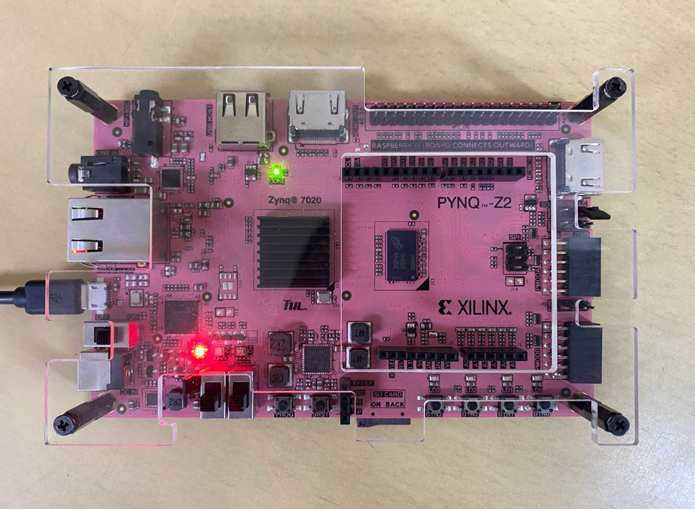
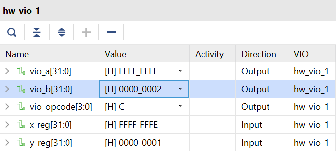

# 32-bit Pipelined ALU on PYNQ-Z2

A 32-bit, 16-opcode ALU in Verilog wrapped with input/output registers (`top_alu`) and verified on a PYNQ-Z2 FPGA board at 125 MHz (`8.000 ns` clock period) using Vivado VIO over JTAG.

## Hardware Setup

## VIO Hardware Test

Live test on the board running 64-bit multiplication (`opcode = C`, `0xFFFF_FFFF * 0x0000_0002 = 0x0000_0001_FFFF_FFFE`), showing the lower 32 bits in `x_reg` and upper 32 bits in `y_reg`:

## Why Pipelining & Registering?

Putting register stages around the ALU in `top_alu` does two useful things:
- **Breaks up long paths:** A 32-bit ALU with wide arithmetic, shifts, and comparisons has a fairly long combinational path on its own. Registering inputs and outputs so it can close timing at 125 MHz (`8.000 ns` period) with positive slack.
- **Clean VIO probing:** Driving `a_reg`, `b_reg`, and `opcode_reg` synchronously on `posedge clk` and capturing `x_reg` and `y_reg` makes reading and driving signals through Vivado's VIO core much more predictable.

## Opcodes

| Opcode | Operation | Output Details |
| :---: | :--- | :--- |
| `0` | Reduction OR (`\|a`) | `x[0]` |
| `1` | Reduction AND (`&a`) | `x[0]` |
| `2` | Reduction XOR (`^a`) | `x[0]` |
| `3` | Bitwise AND (`a & b`) | `x` |
| `4` | Bitwise OR (`a \| b`) | `x` |
| `5` | Bitwise XOR (`a ^ b`) | `x` |
| `6` | Greater than (`a > b`) | `x[0]` |
| `7` | Less than (`a < b`) | `x[0]` |
| `8` | Logical NOT (`!a`) | `x[0]` |
| `9` | Equality (`a == b`) | `x[0]` |
| `10` | Addition (`a + b`) | Sum in `x`, carry-out in `y[0]` |
| `11` | Subtraction (`a - b`) | `x` |
| `12` | Multiplication (`a * b`) | Lower 32 bits in `x`, upper 32 bits in `y` |
| `13` | Logical right shift (`a >> b[4:0]`) | `x` |
| `14` | Logical left shift (`a << b[4:0]`) | `x` |
| `15` | Bitwise NOT (`~a`) | `x` |

## Tricky Bits & Lessons Learned

- **Closing timing at 125 MHz:** Getting timing closure at `8.000 ns` on the Zynq-7000 wasn't instant, it took registering I/O cleanly, keeping shift amounts masked to 5 bits (`b[4:0]`) for 32-bit shifts, and leaning on Vivado implementation strategies (`Performance_Explore`) to clear tight setup slack.
- **Splitting wide results across `x` and `y`:** Since the ALU outputs two 32-bit buses (`x` and `y`), keeping track of where carry-out (`y[0]`) and the upper 32 bits of multiplication (`y`) land—versus single-result ops that only use `x`, was super important during VIO checks.

## Repo Layout

- `rtl/ALU.v` — 32-bit combinational ALU core with 16 opcodes
- `rtl/top_alu.v` — Top-level register stage and Vivado VIO (`vio_0`) wrapper
- `tb/tb_ALU.v` — Testbench stepping through opcodes `0`–`15`
- `constraints/pynq_z2_alu.xdc` — Pin/clock (`H16`, 125 MHz) and debug hub constraints
- `docs/` — Board photo and VIO test screenshot
